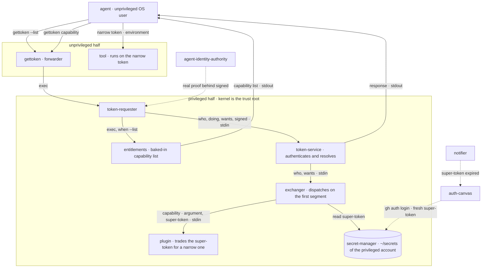
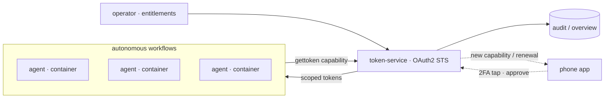

A text-based, shell-native token broker for AI agents.

## The problem

Agents need the same tools people use, and those tools ask for a person. A
browser opens, a login is typed, a prompt waits for someone to approve. An agent
cannot answer any of it.

Handing the agent a long-lived credential instead removes that obstacle and
creates a worse one. An agent can be talked into things by whatever it reads, and
it can simply malfunction. Whatever authority it holds is the authority that goes
wrong.

`gettoken` gives an agent a token narrow enough for the job in front of it and
nothing more, drawn from the credentials a human already holds. The agent never
holds the super-token: it says what it wants, and gets back a token for that job
and nothing else.

Accountability stays with the human. The human holds the super-token and grants
pieces of it. This repository is retired when reasoning alone makes an agent
trustworthy enough that nobody needs to hold a super-token and hand out pieces of
it.

## Principles

1. **Package the tools humans already built.** We write no new tooling. The test
   for anything added: does it replace the tool, or supply what the tool needs?
   Replacing is a parallel path; supplying is packaging.
2. **Non-intrusive.** A tool package does not change the tool. Nothing is
   rewritten, no credential is left behind, and removing the package leaves
   nothing behind either.
3. **Functional from the start.** Every component exists from the first commit at
   whatever depth it needs, and the chain runs end to end at every commit. There
   is no state in which the system is half-built and waiting to be wired up.
4. **Modular, evolvable one piece at a time.** The schemas in `contracts/` are
   fixed; what sits behind them is not. Any component can be replaced or deepened
   without its neighbours noticing.
5. **Scalable by adding tools.** A tool is integrated by publishing a package that
   depends on `gettoken`. Nothing central is edited, so the hundredth tool costs
   what the first one did.

## Components

Fixed faces (name + concern). The implementation of each evolves left to right.

| # | Component | Concern | Beginning | Future |
|---|-----------|---------|-----------|--------|
| 1 | `gettoken` | agent's entry point; `--list` and `<capability>` | forwarder | stable |
| 2 | `token-requester` | privileged half; builds the request | local root/dev | gh app signing → orchestrator/container id |
| 3 | `token-service` | authenticate, resolve, hand the capability to the exchanger | transitive trust, as-is | verify `signed` → off-the-shelf OAuth2 STS |
| 4 | `notifier` | summon a human to renew | beep + shell | 2FA/phone → mostly automated |
| 5 | `auth-canvas` | surface the human acts on | prepped shell (`gh auth login`) | mobile/web |
| 6 | `secret-manager` | holds super-tokens on the privileged side, keyed by who holds them and which service they are for | privileged folder | secrets manager |
| 7 | `entitlements` | what an agent may equip | script entry | operator-managed |
| 8 | `agent-identity-authority` | proves who the agent is | local OS user | gh app signed → GCP service principal |
| 9 | `exchanger` | trades a super-token for a narrow one, through the plugin installed for the service | one plugin per capability segment, found in `/usr/lib/gettoken/exchangers` | a plugin is its own package, beside the tool it integrates |
| 10 | `renewer` | obtains a fresh super-token for one service, with a human present | runs the tool's own login | device flow → phone approval |

Components 1–8 are shared. 9 and 10 are shipped once per integrated tool: each
knows one service, and neither knows anything about the others.

`gettoken` writes the token and nothing else. The response document stays between
`token-service` and `token-requester`; none of it reaches the agent. A failure
writes to stderr and leaves stdout empty, so a caller cannot assign an error
message to a credential. The agent asks again every time it needs a token — it is
not told when one expires and does not track one. Caching belongs to the
privileged half.

`token-service` hands the request to the exchanger, which dispatches on the
first segment of the capability to the plugin installed for that segment. A plugin
translates the capability into whatever that service actually wants — for GitHub a
set of permissions on the repository named in the capability, not GitHub's own
coarse scopes. The token lives as short a time as possible, ideally two minutes.

## Architecture

The request path. `gettoken` is the only face the agent sees; everything past
the privilege boundary is the trusted half. The super-token never crosses back —
the exchanger reads it from the store and hands it to the plugin, and what comes
back is the narrow token the plugin wrote.



## Install it

```sh
curl -fsSL https://thruput.se/apt/thruput-io.sources \
  | sudo tee /etc/apt/sources.list.d/thruput-io.sources > /dev/null
sudo apt-get update
sudo apt-get install integration-test-tool
```

```sh
brew tap thruput-io/tap
brew trust thruput-io/tap
brew install integration-test-tool
```

## Vision

Many agents running autonomous workflows in containers, self-serving scoped
tokens from an OAuth2 STS. The operator sets what each agent may equip;
everything is audited. A human is pulled in only for approvals — a tap on a
phone to renew a super-token or grant a new capability.


